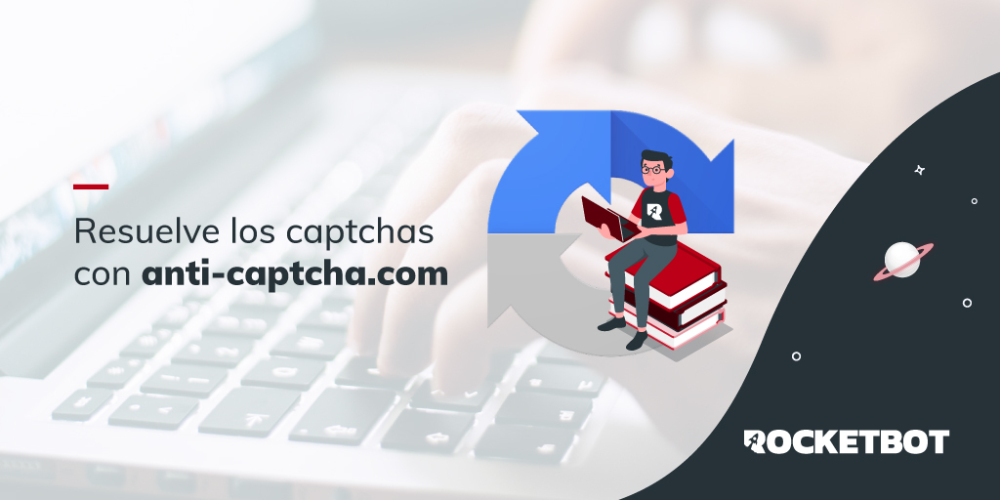

# Anticaptcha
  
Módulo para resolver captchas con anti-captcha  

*Read this in other languages: [English](Manual_Anticaptcha.md), [Português](Manual_Anticaptcha.pr.md), [Español](Manual_Anticaptcha.es.md)*
  

## Como instalar este módulo
  
Para instalar el módulo en Rocketbot Studio, se puede hacer de dos formas:
1. Manual: __Descargar__ el archivo .zip y descomprimirlo en la carpeta modules. El nombre de la carpeta debe ser el mismo al del módulo y dentro debe tener los siguientes archivos y carpetas: \__init__.py, package.json, docs, example y libs. Si tiene abierta la aplicación, refresca el navegador para poder utilizar el nuevo modulo.
2. Automática: Al ingresar a Rocketbot Studio sobre el margen derecho encontrara la sección de **Addons**, seleccionar **Install Mods**, buscar el modulo deseado y presionar install.  

## Descripción de los comandos

### Resolver ReCaptcha
  
Resuelve ReCaptcha con API de https://anti-captcha.com
|Parámetros|Descripción|ejemplo|
| --- | --- | --- |
|Key Anticaptcha|Key de su cuenta anticaptcha|Key|
|Url de la página que tiene ReCaptcha|Url de la página a la que se le va a resolver el ReCaptcha|Url de la página|
|Token ReCaptcha|Token ReCaptcha que se obtiene en la página que tiene ReCaptcha|Token|
|Variable donde se almacena el resultado de Anticaptcha|Variable donde se almacena el resultado de Anticaptcha|Variable|

### Resolver Captcha Imagen
  
Resuelve un Captcha tipo imagen con API de https://anti-captcha.com
|Parámetros|Descripción|ejemplo|
| --- | --- | --- |
|Key Anticaptcha|Key de su cuenta de anticaptcha|Key|
|Ruta a la imagen en su equipo|Ruta a la imagen que se desea resolver|C:/Users/User/Desktop/captcha.png|
|Variable donde se almacena el resultado de Anticaptcha|Variable donde se almacena el resultado|Variable|

### Resolver hCaptcha 
  
Resuelve un Captcha tipo hCaptcha con API de https://anti-captcha.com
|Parámetros|Descripción|ejemplo|
| --- | --- | --- |
|Key Anticaptcha|Key de su cuenta de anticaptcha|Key|
|Token HCaptcha|Token HCaptcha que se obtiene en la página que tiene HCaptcha|Token|
|URL de la página con hCaptcha|URL de la página donde se encuentra el hCaptcha|URL|
|rqdata|Opcional. Dato extra que algunos sitios usan para validar hCaptcha. Solo completarlo si la página muestra 'rqdata'.|rqdata|
|Variable donde se almacena el resultado de Anticaptcha|Variable donde se almacena el resultado|Variable|
